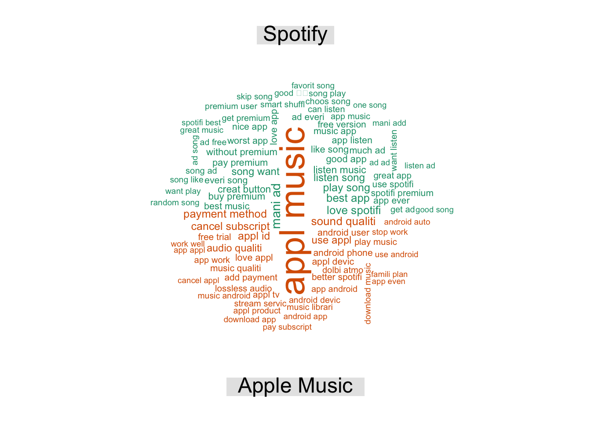

# Text Mining Analysis of Music Streaming App Reviews

A text mining project in R comparing how users perceive **Spotify** and
**Apple Music** through Google Play Store reviews, combining multiple
text analysis techniques to extract marketing insights.

## 📊 Full Report

[View the full analysis here](https://vladyslava-stepanovska.github.io/text-mining-music-streaming-reviews/analysis.html)

## 📋 Overview

This project applies a text mining pipeline to user reviews of music
streaming apps, with a focus on comparing Spotify and Apple Music. By
combining word frequency analysis, sentiment analysis, topic modeling,
and text embeddings, the project explores the differences in how
users perceive the two platforms and translates these into actionable
marketing insights.

## 📈 Results

The analysis covers **29,994 Google Play reviews** (14,999 Spotify, 14,995 Apple Music).

**Users talk about different things.** The bigram comparison cloud shows the phrases that are most distinctive for each app. Spotify reviews focus on everyday use and the free-to-premium trade-off (premium, ads, songs, playlists), while Apple Music reviews focus on subscription logistics (payment method, cancelling subscriptions, free trials), sound quality and device compatibility.



**Topic modelling (LDA on bigrams) confirms these themes:** Apple Music topics contain phrases such as *payment method*, *cancel subscription* and *sound quality*, while Spotify topics contain *many ads* and *buy premium* alongside positive phrases such as *love Spotify*.

**Spotify reviews are more positive.** Among reviews that contain sentiment words, the average net sentiment (positive minus negative words) is **0.73 for Spotify vs. 0.44 for Apple Music**.

**Marketing recommendations derived from the analysis:**
-   **Spotify:** build on users' positive emotional connection, ease of use and discovery features such as playlists, while reducing ad fatigue and making the benefits of Premium clearer to ease the free-to-premium transition
-   **Apple Music:** simplify subscription and payment processes, reduce technical friction and use clear, supportive communication to rebuild trust, while reinforcing its strengths in audio quality and integration with Apple devices

## 📂 Project Structure

```         
├── analysis.Rmd                  # Full analysis and code
├── analysis.html                 # Rendered report
├── assets/                       # Figures used in this README
└── README.md
```

## 🧩 Methods

-   **Text Preprocessing** — tokenization, stopword removal, stemming
-   **Word Frequency Analysis** — unigrams, commonality and comparison
    clouds
-   **Word Networks** — bigram and trigram network graphs
-   **Sentiment Analysis** — polarity scoring and sentiment over time
-   **Topic Modeling** — LDA with unigrams and bigrams, comparison with
    text2vec
-   **Text Embeddings** — word2vec, UMAP visualization, semantic vector
    arithmetic, cluster dendrograms

## 📦 R Packages

`tm`, `SnowballC`, `dplyr`, `wordcloud`, `RWeka`, `RColorBrewer`, `tidyr`, 
`igraph`, `ggraph`, `tidytext`, `lubridate`, `ggthemes`, `ggplot2`, `syuzhet`, 
`plotly`, `topicmodels`, `text2vec`, `word2vec`, `proxy`, `umap`, `ggrepel`

## 📁 Dataset

Google Play Store reviews for music streaming apps, sourced from Kaggle:
[Google Play Music App Reviews](https://www.kaggle.com/datasets/cluesec/google-play-music-app-reviews)

## 🔍 Key Findings

-   Spotify reviews emphasize **ads, playlists, and discovery
    features**, with more polarized sentiment
-   Apple Music reviews focus on **iTunes integration, subscription
    costs, and technical issues**, with consistently less positive
    sentiment
-   LDA and embedding analyses uncover distinct user pain points for
    each platform
-   Findings are translated into **marketing strategy recommendations**

## 👤 Author

Vladyslava Stepanovska